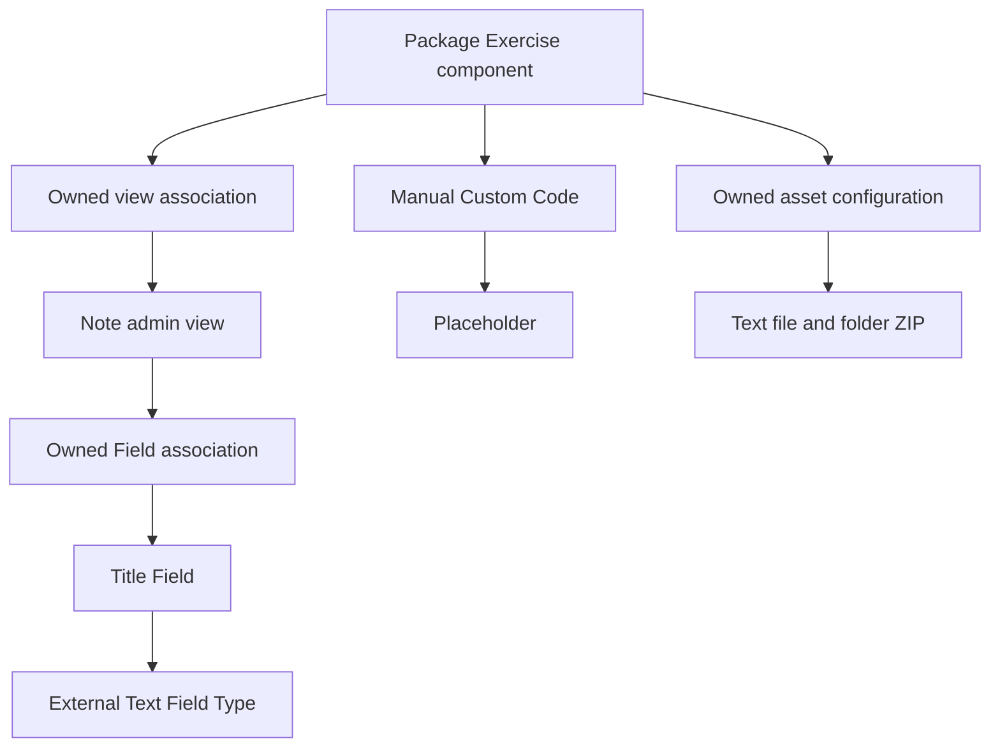

# Package Exercise: original transport fixture

This is a complete small **package transport graph**, authored for the documentation. It has one component, one Note admin view, one Title Field, three owned child records, a manual Custom Code contribution, one Placeholder and two transported assets. It is an input repository, not an installable Joomla extension. Its intended component target is Joomla 6; no compilation or runtime success is implied by the fixture's existence.

The records contain the fields needed for this declared example, with optional features disabled or absent. They are not a universal list of required fields, a replacement for every export field, or a template for clearing an existing row: the [reference](../../reference/README.md) distinguishes omission, null and explicit empty values. Use fresh local records when evaluating creation. Preserve intentional values when evaluating an update.

## Graph and identities



Arrows show why records are needed, not the serialized `direction` value. A parent's owned-child descriptor is `in`; child-to-parent and reusable-definition references are `out`. The child backlink creates an expected graph cycle. File/folder descriptors use their distinct asset shape without `direction`.

| Role | Identity | Authority |
| --- | --- | --- |
| Component | `89db4e90-ea7e-42e2-9805-94b22cf6d636` | Reserved new fixture UUIDv4 |
| Admin view | `6a143e5b-0c94-4fb6-92e7-91cec3928e7b` | Reserved new fixture UUIDv4 |
| Field | `40755c41-41af-4c23-92df-c8470d7ca513` | Reserved new fixture UUIDv4 |
| `component_admin_views`, `component_files_folders` | Component's GUID under key `joomla_component` | Parent-addressed child, no separate UUID |
| `admin_fields` | Admin view's GUID under key `admin_view` | Parent-addressed child, no separate UUID |
| Manual Custom Code | `aidocPackageReadme` under `function_name` | Reserved fixture natural key |
| Placeholder | `[[[aidoc_package_label]]]` under `target` | Reserved fixture natural key |
| External Text Field Type | `201327fe-3067-4316-a155-3fe2a52e05c0` | Existing core dependency, retained deliberately |

The three new UUIDs were generated using the cryptographic `crypto.randomUUID()` system facility and checked against every typed index entry in the three [pinned package repositories](../../repositories.md) on 2026-10-31. The two fixture natural keys were also absent from those indexes. This dated check is provenance for a reserved example, not a substitute for current collision checks when creating an application.

## Exact layout

There are nine indexes, eight entity/child payloads and two asset files. Each local dependency resolves to one of these records; the one intentional external definition is the core Text Field Type.

| Index | Payload located by its row |
| --- | --- |
| [joomla-component.json](index/joomla-component.json) | [Component item](src/joomla_component/89db4e90-ea7e-42e2-9805-94b22cf6d636/item.json) |
| [component-admin-views.json](index/component-admin-views.json) | [Component's view association](src/joomla_component/children/89db4e90-ea7e-42e2-9805-94b22cf6d636/component-admin-views.json) |
| [admin-view.json](index/admin-view.json) | [Note admin view](src/admin_view/6a143e5b-0c94-4fb6-92e7-91cec3928e7b/item.json) |
| [admin-fields.json](index/admin-fields.json) | [View's Field association](src/admin_view/children/6a143e5b-0c94-4fb6-92e7-91cec3928e7b/admin-fields.json) |
| [field.json](index/field.json) | [Title Field](src/field/40755c41-41af-4c23-92df-c8470d7ca513/item.json) |
| [custom-code.json](index/custom-code.json) | [Manual Custom Code](src/custom_code/aidocPackageReadme/item.json) |
| [placeholder.json](index/placeholder.json) | Placeholder item at `src/placeholder/[[[aidoc_package_label]]]/item.json` |
| [component-files-folders.json](index/component-files-folders.json) | [Component's asset configuration](src/joomla_component/children/89db4e90-ea7e-42e2-9805-94b22cf6d636/component-files-folders.json) |
| [file_folder.json](index/file_folder.json) | `src/file_folder/c3f64e43-5f0c-5b58-8aad-cb1f61ad9fad.txt` and `src/file_folder/54376eec-75f2-5d0c-a47a-6c9bd8e9a4e7.zip` |

Keep each ordinary row's `settings` consistent with `path` and its entity's configured settings filename. The inspected importer fetches `path + configured settings_name`; `settings` is not an alternate fetch override. The asset row has only `name`, `path` and `guid`; its path names the content itself. Filenames, case and the natural-key delimiters are meaningful. JSON files use tabs for indentation. Code/XML strings are ordinary JSON strings containing decoded source, not a second base64 layer.

## Natural-key and Field Type boundaries

The component README contains `[CUSTOMCODE=aidocPackageReadme]`. Its dependency targets `custom_code/function_name/aidocPackageReadme`. That record's raw text contains `[[[aidoc_package_label]]]`, and its dependency targets `placeholder/target/[[[aidoc_package_label]]]`. The placeholder's value is `package graph`. The index field named `guid` carries these exact natural keys; it is not a UUID field for these entities. This is the manual Custom Code case (`target: 2`), not automation/hash-targeted Custom Code.

The Title Field's `fieldtype` and outgoing dependency both reference the existing core Text Field Type. Its `xml` is an XML string that configures **this application Field**: `name="title"`, required input, a 120-character limit and text filtering. The SQL-length selector uses `datalenght: "Other"` with `datalenght_other: "120"`, preserving JCB's spelling and actual selector contract rather than inventing a `120` option. The `admin_fields` child gives that Field its title/list/search/sort role in the Note view. These are three distinct responsibilities; importing the Field Type alone does not create the application Field or attach it to a view. See the [Field Types module](../../../field-types/README.md).

Inactive defaults need context too. The view keeps `source: 0` while `add_sql: 0`; the manual Custom Code keeps `type: 0` while `target: 2`. In the inspected [Admin View script](https://github.com/vdm-io/Joomla-Component-Builder/blob/408703a857ad937479b1e28de7f693af178dcc83/media/js/admin/admin_view.js) and [Custom Code script](https://github.com/vdm-io/Joomla-Component-Builder/blob/408703a857ad937479b1e28de7f693af178dcc83/media/js/admin/custom_code.js), those conditions hide the corresponding controls and remove their required state. Do not select a different active option merely because the inactive default is absent from the radio's option list. The component's disabled custom-path switches use their empty-string option instead.

This fixture contains no Super Power token. The [reference trace](../reference-traces.md#field-types-and-powers-are-separate-contracts) shows that separate boundary using actual upstream specimens; adding a token would require the Power's own catalogue, source, dependencies and compiler/runtime validation.

## From an empty repository

For a genuinely new application, create an empty repository and author fresh records through the [creation workflow](../../workflows/create-repository.md). A minimal initially empty component catalogue is an object, not an array:

```bash
set -euo pipefail
NEW_REPO=/absolute/path/to/new-blueprint
test ! -e "$NEW_REPO"
git init --initial-branch=master "$NEW_REPO"
mkdir -p "$NEW_REPO/index" "$NEW_REPO/src"
printf '{}\n' > "$NEW_REPO/index/joomla-component.json"
```

`master` is the chosen branch in this example, not a package-format requirement. Use the actual authorized branch and configure its read/write roles explicitly; the upstream Hello World reference uses `main`. At this point there is no component to initialize or compile. Add the repository's purpose, source/target policy, license and an agent pointer, then use fresh JCB records with collision-checked identities and the approved Package write target to export the intended graph. Export emits the applicable entity indexes and parent-addressed sidecars. Compare its layout with this example and inspect every emitted field and dependency; do not fabricate unrelated empty indexes solely to resemble a large repository.

For a disposable test **of this exact maintained fixture**, copy this directory intact to an authorized test repository and retain these reserved identities and provenance. Check that they are absent from the disposable destination JCB first; if they already exist, use the documented update path and preserve local work. Do not publish such a copy as a newly authored application. Creating a distinct application requires new root/view/Field UUIDs, unique natural keys and coherent rewrites of index keys, paths, parent relationships, nested references, dependency descriptors and literal Custom Code/placeholder calls. Asset keys follow destination normalization rather than random UUID allocation. Changing only a component name or directory is insufficient.

## Validation and execution

Run the package validator from the distribution root, adding a reviewed checkout of the actual external Field Type source:

```bash
FIELD_TYPE_REPO=/absolute/path/to/joomla-fieldtypes
bash tools/validate-package-repository.sh packages/examples/minimal-repository \
	--with "$FIELD_TYPE_REPO"
```

The standalone fixture produces unresolved-reference exit `2`; with that core catalogue the intended result is static exit `0`. The additional catalogue establishes indexed identity availability, not a completed Field Type payload/import test. The validator separately defers the Field association's `tab: "1"` context link: confirm that it selects the view's `Details` tab in JCB and generated output. That value is not a newly allocated global GUID. The external dependency must still be resolved through the Field Type channel; do not copy its definition into `src/fieldtype` to hide the boundary. Inspect the [asset checks](../assets.md) as well.

Then follow [Playground acceptance](../../workflows/validate-and-integrate.md): use a Package repository target and the candidate read branch, inspect every persisted relationship, confirm the external Text definition, compile the actual component, inspect the Note form/list and asset placement, install it and create/edit/list a note. Confirm the 120-character input limit and saved value, permissions, language output and intended README substitution. A successful compile of another component does not test this graph.

Source/shape and archive checks are distinct from installed JCB results. Record actual stages in [verification](../../verification.md); do not infer import or runtime success from this procedure. Any lasting correction belongs in the appropriate fixture payload or owning blueprint, followed by regeneration and retesting.

## Provenance and licensing

Original fixture content is dedicated under [CC0 1.0](LICENSE). Names, prose, XML configuration and text assets were authored for this example. The model layout and field semantics were inspected in the pinned JCB implementation, while the larger upstream graphs are linked as reference evidence rather than copied or relicensed. The external Field Type and generated Joomla/JCB/library material retain their own licenses and attribution requirements.
