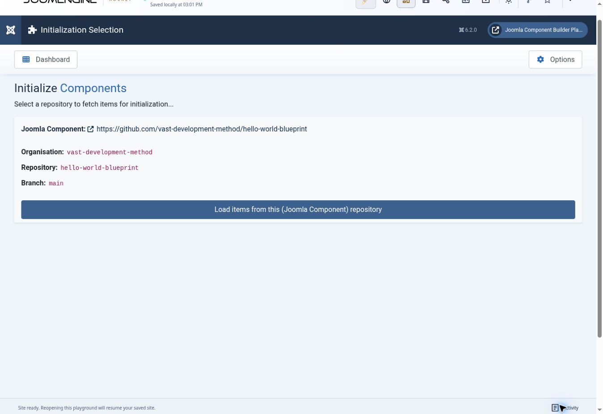

# Package verification record

Inspected on **31 October 2026**. This record separates source-derived contracts, offline validation and observed browser execution. It does not certify every package entity/field combination or every Joomla target.

## Source and structural evidence

- JCB `6.x@408703a857ad937479b1e28de7f693af178dcc83` exposes 42 Package Remote Config classes and 41 logical contracts: 40 database models with matching forms and the virtual file/folder contract. The generated inventory covers 527 serialized top-level fields and retains nested Table/form metadata in the per-entity references.
- The three supplied repositories were inspected at the revisions in [repositories](repositories.md). Corpus counts and overlaps are observations of those snapshots; the attached MCP proposal's older counts are not current validation results.
- The [original minimal fixture](examples/README.md) contains eight JSON records and two raw assets. It passes the bounded package profile when its external Field Type catalogue is supplied; the standalone unresolved dependency is reported separately. The fixture is not claimed to have been compiled or installed.
- Independent source review confirmed the documented identity exceptions, decoding/null handling, Init/Pull/Reset scope, Push destinations, index-update and asset-transfer limitations. These are code observations, not proof that each edge case has run in a deployed installation.

The combined offline check passed with jq 1.8.1 and PHP 8.3.6: **108 regression checks** (34 Powers, 41 Field Types/Snippets and 33 Packages), JSON, documentation links and registry/skill-entry checks. ShellCheck and whitespace checks passed. Contract regeneration reproduced the maintained references. Independent review verified all 83 distinct recorded JCB source-file hashes, the 41-model routing coverage, and four meaningful malformed inputs against the real validator. Skill Creator's metadata validator accepted the root, four model entry points and Playground entry point. These checks do not establish client installation or automatic skill discovery.

## Reference corpus and agent-routing checks

The final static profile was run against all three source snapshots, supplying the external Field Type catalogue. Counts include parent-key child records and raw assets.

| Corpus | JSON records | Raw assets | Final static result |
| --- | ---: | ---: | --- |
| `joomengine/packages` | 564 | 56 | Exit 1: strict authoring minimum rejects 10 empty child exports |
| `joomengine/joomla-packages` | 312 | 21 | Exit 1: strict authoring minimum rejects 13 empty child exports |
| `vast-development-method/hello-world-blueprint` | 33 | 4 | Exit 0: bounded static pass; three context-local references deferred |

The first two catalogues contain genuine JCB-exported child objects with only their parent key populated. The validator's nonempty-content minimum is an **authoring quality gate**, not a claim that this exporter output is corrupt or cannot be imported. See [validator limits](../tools/README.md) and [repository observations](repositories.md) before applying it to historical exports. The final failed runs do not establish dependency closure for those catalogues. An independent field-profile audit of their 876 JSON records found the same 23 empty-child cases and no other field-profile violation; it is not a full dependency or compiler check.

An existing collaborating agent exercised the distributed routing for a new Joomla 6 module plus component options: root skill → package skill → entity router → module/component guides → field metadata → Playground authoring → validator help. It found and corrected CRUD-biased GUI wording. This was a routing exercise, not a fresh-session authoring test, a client installation test, or a compiled implementation. The complete distribution must remain available for shared-resource links to resolve.

## Observed browser exercise: catalogue acquisition unresolved

The agent resumed the previously used saved public Playground site, using Joomla/JCB 6.2.0 and PHP 8.4.1 from the earlier observed deployment. A separate temporary launch encountered browser protocol timeouts; its incomplete tab was closed. The saved site's Joomla session had expired; reloading the saved deployment with its existing automatic-login configuration restored the administrator screen. No credential was supplied or authentication setting weakened.

The agent created and saved a public read-only repository connection named **AI Package Hello World verification** (local ID `27`), using GitHub, the Packages target, organisation `vast-development-method`, repository `hello-world-blueprint`, and read branch `main`. Write branch and token were left empty. Existing GitHub/Codeberg package mirror records were visibly unpublished. The component list initially contained only **Demo J6**, local ID `92`.

Joomla Components → Init displayed the explicitly configured Hello World source and `main` branch. Activating **Load items from this (Joomla Component) repository** temporarily disabled the button, but subsequent observations showed the same source card without an item list or visible JCB error. The Activity panel showed deployment/resume information, not a package-import result. The cause was not established. This is an unresolved catalogue-acquisition result in this browser session, not evidence that Playground or the source repository is generally broken.

The screenshot records the selected source, not successful acquisition. **No package import, Pull/Reset refresh, compilation, installation, runtime exercise or Push/export was completed.** No write token was supplied. Resume from catalogue loading in a disposable instance, record the actual error or selection result, then execute each applicable acceptance stage. Do not promote this receipt to an end-to-end pass.

## Acceptance limits

Follow [package acceptance](workflows/validate-and-integrate.md) for the candidate being changed. Record import/update, authoring persistence, Push/remote read-back, compilation, installation and runtime separately. A successful reference import will not validate newly authored fixture identities, arbitrary staging branches, external credentials or all sub-models. A package consumer containing Joomla Power tokens does not establish Super Power execution.

The prior shared [Regex receipt](../testing/playground/verification.md) is evidence for its Power import only. No remote package source has been published from the browser exercise, and no issue has been submitted.
